# Entity-relationship diagram

Generated from the SQLAlchemy models with `python -m app.scripts.generate_erd`. Regenerate after a schema change.

## Tables

- users: accounts (student, teacher, admin), preferences.
- documents: one row per uploaded or linked source; `encryption_key_id` names the AES key.
- document_chunks: indexed passages with embeddings, page, section title and video timestamp.
- topics / document_topics: topics found in documents, and which document holds them.
- topic_progress: per-student accuracy, level and review schedule per topic.
- quizzes / questions / quiz_attempts / question_responses: generated quizzes and every answer.
- path_events: course-map re-routing log. light_episodes: mood-aware lighter-step episodes.
- past_paper_questions / exam_topic_scores: Exam Predictor evidence and rankings.
- teacher_style_profiles: the style learned from teacher material.
- classes / class_members / class_documents: teacher classes, enrolment by join code, shared material.
- chat_threads / chat_messages / chat_citations / message_feedback: tutor chats with the passages each answer cited.
- peer_challenges / peer_blocks: Peer Match duels and blocks.
- viva_sessions / viva_turns: oral exam sessions, questions, answers and scores.
- notifications: study reminders.
- eval_datasets / eval_items / eval_runs / eval_results: the Evaluation Lab.

## Diagram

```mermaid
erDiagram
    chat_citations {
        CHAR id PK
        CHAR message_id FK
        CHAR chunk_id FK
        CHAR document_id FK
        VARCHAR document_title
        INTEGER page_number
        VARCHAR section_title
        INTEGER start_seconds
        VARCHAR source_url
        BOOLEAN is_teacher
        INTEGER marker
        TEXT snippet
    }
    chat_messages {
        CHAR id PK
        CHAR thread_id FK
        CHAR user_id FK
        VARCHAR role
        TEXT content
        TEXT standalone_query
        BOOLEAN rewrite_used
        BOOLEAN rewrite_fallback
        BOOLEAN abstained
        BOOLEAN teacher_style
        BOOLEAN simplified
        VARCHAR status
        VARCHAR model
        JSON latency_ms
        DATETIME created_at
    }
    chat_threads {
        CHAR id PK
        CHAR user_id FK
        VARCHAR title
        DATETIME created_at
        DATETIME updated_at
    }
    class_documents {
        CHAR class_id PK
        CHAR document_id PK
        DATETIME shared_at
    }
    class_members {
        CHAR class_id PK
        CHAR student_id PK
        DATETIME joined_at
    }
    classes {
        CHAR id PK
        CHAR teacher_id FK
        VARCHAR name
        VARCHAR join_code
        DATETIME created_at
    }
    document_chunks {
        CHAR id PK
        CHAR document_id FK
        CHAR user_id FK
        INTEGER chunk_index
        TEXT content
        INTEGER page_number
        VARCHAR section_title
        INTEGER start_seconds
        VECTOR embedding
        TSVECTOR tsv
        DATETIME created_at
    }
    document_topics {
        CHAR document_id PK
        CHAR topic_id PK
        INTEGER position
        INTEGER first_page
        INTEGER last_page
        VARCHAR heading
    }
    documents {
        CHAR id PK
        CHAR user_id FK
        VARCHAR title
        VARCHAR original_filename
        VARCHAR storage_path
        VARCHAR encryption_key_id
        VARCHAR mime_type
        INTEGER file_size
        VARCHAR status
        VARCHAR error_message
        INTEGER page_count
        VARCHAR source_url
        DATETIME questions_extracted_at
        VARCHAR kind
        INTEGER exam_year
        VARCHAR exam_session
        DATETIME created_at
        DATETIME updated_at
    }
    eval_datasets {
        CHAR id PK
        CHAR user_id FK
        VARCHAR name
        DATETIME created_at
    }
    eval_items {
        CHAR id PK
        CHAR dataset_id FK
        INTEGER position
        TEXT question
        BOOLEAN answerable
        VARCHAR gold_document_title
        INTEGER gold_page
        VARCHAR question_type
        VARCHAR concept
    }
    eval_results {
        CHAR id PK
        CHAR run_id FK
        CHAR item_id FK
        BOOLEAN answered
        BOOLEAN passed
        INTEGER first_relevant_rank
        JSONB retrieved
        FLOAT latency_ms
        VARCHAR error
    }
    eval_runs {
        CHAR id PK
        CHAR user_id FK
        CHAR dataset_id FK
        VARCHAR status
        JSONB config
        JSONB metrics
        VARCHAR error_message
        INTEGER items_done
        INTEGER items_total
        DATETIME created_at
        DATETIME started_at
        DATETIME finished_at
    }
    exam_topic_scores {
        CHAR user_id PK
        CHAR topic_id PK
        INTEGER score
        VARCHAR label
        BOOLEAN pinned
        DATETIME updated_at
    }
    light_episodes {
        CHAR id PK
        CHAR user_id FK
        CHAR topic_id FK
        VARCHAR reason
        DATETIME started_at
        DATETIME ended_at
        VARCHAR outcome
        JSONB recap
        CHAR confidence_quiz_id FK
    }
    message_feedback {
        CHAR id PK
        CHAR message_id FK
        CHAR user_id FK
        VARCHAR rating
        VARCHAR reason
        DATETIME created_at
    }
    notifications {
        CHAR id PK
        CHAR user_id FK
        VARCHAR type
        VARCHAR title
        TEXT body
        VARCHAR link
        DATETIME read_at
        DATETIME created_at
    }
    past_paper_questions {
        CHAR id PK
        CHAR user_id FK
        CHAR document_id FK
        INTEGER position
        TEXT question_text
        INTEGER marks
        INTEGER page_number
    }
    path_events {
        CHAR id PK
        CHAR user_id FK
        CHAR topic_id FK
        VARCHAR old_status
        VARCHAR new_status
        VARCHAR reason
        DATETIME created_at
    }
    peer_blocks {
        CHAR id PK
        CHAR user_id FK
        CHAR blocked_user_id FK
        VARCHAR reason
        DATETIME created_at
    }
    peer_challenges {
        CHAR id PK
        CHAR challenger_id FK
        CHAR opponent_id FK
        VARCHAR topic_name
        VARCHAR difficulty
        VARCHAR status
        CHAR challenger_quiz_id FK
        CHAR opponent_quiz_id FK
        INTEGER challenger_score
        INTEGER challenger_total
        INTEGER challenger_time_seconds
        INTEGER opponent_score
        INTEGER opponent_total
        INTEGER opponent_time_seconds
        CHAR winner_id FK
        DATETIME expires_at
        DATETIME created_at
        DATETIME completed_at
    }
    question_responses {
        CHAR id PK
        CHAR attempt_id FK
        CHAR question_id FK
        INTEGER submitted_index
        BOOLEAN is_correct
        DATETIME created_at
    }
    questions {
        CHAR id PK
        CHAR quiz_id FK
        INTEGER position
        CHAR topic_id FK
        TEXT question_text
        VARCHAR question_type
        JSONB options
        INTEGER correct_index
        TEXT explanation
        JSONB sources
    }
    quiz_attempts {
        CHAR id PK
        CHAR user_id FK
        CHAR quiz_id FK
        INTEGER score
        INTEGER total_questions
        DATETIME completed_at
    }
    quizzes {
        CHAR id PK
        CHAR user_id FK
        VARCHAR title
        CHAR topic_id FK
        VARCHAR difficulty
        VARCHAR kind
        JSONB source_document_ids
        DATETIME created_at
    }
    teacher_style_profiles {
        CHAR user_id PK
        VARCHAR signature
        JSONB glossary
        JSONB phrases
        JSONB structure
        DATETIME created_at
    }
    topic_progress {
        CHAR id PK
        CHAR user_id FK
        CHAR topic_id FK
        INTEGER attempt_count
        INTEGER correct_count
        VARCHAR current_difficulty
        INTEGER failed_streak
        BOOLEAN needs_support
        INTEGER consecutive_slip_passes
        DATETIME last_practiced_at
        DATETIME updated_at
    }
    topics {
        CHAR id PK
        CHAR user_id FK
        VARCHAR name
    }
    users {
        CHAR id PK
        VARCHAR email
        VARCHAR password_hash
        BOOLEAN is_admin
        VARCHAR role
        VARCHAR display_name
        BOOLEAN lighter_steps_enabled
        BOOLEAN peer_match_opt_in
        BOOLEAN reminders_enabled
        INTEGER reminder_hour_utc
        DATETIME created_at
    }
    viva_sessions {
        CHAR id PK
        CHAR user_id FK
        VARCHAR topic_name
        VARCHAR status
        INTEGER tab_switch_count
        INTEGER total_score
        INTEGER max_score
        TEXT overall_feedback
        DATETIME created_at
        DATETIME completed_at
    }
    viva_turns {
        CHAR id PK
        CHAR session_id FK
        INTEGER turn_index
        TEXT question_text
        JSONB source_citations
        TEXT student_answer
        TEXT follow_up_question
        TEXT follow_up_answer
        INTEGER grade_accuracy
        INTEGER grade_completeness
        INTEGER grade_own_words
        INTEGER grade_score
        TEXT grade_feedback
        TEXT ideal_answer
        DATETIME created_at
    }
    users ||--o{ chat_threads : "user_id"
    chat_threads ||--o{ chat_messages : "thread_id"
    users ||--o{ chat_messages : "user_id"
    chat_messages ||--o{ chat_citations : "message_id"
    document_chunks ||--o{ chat_citations : "chunk_id"
    documents ||--o{ chat_citations : "document_id"
    chat_messages ||--o{ message_feedback : "message_id"
    users ||--o{ message_feedback : "user_id"
    users ||--o{ classes : "teacher_id"
    classes ||--o{ class_members : "class_id"
    users ||--o{ class_members : "student_id"
    classes ||--o{ class_documents : "class_id"
    documents ||--o{ class_documents : "document_id"
    users ||--o{ documents : "user_id"
    documents ||--o{ document_chunks : "document_id"
    users ||--o{ document_chunks : "user_id"
    users ||--o{ eval_datasets : "user_id"
    eval_datasets ||--o{ eval_items : "dataset_id"
    users ||--o{ eval_runs : "user_id"
    eval_datasets ||--o{ eval_runs : "dataset_id"
    eval_runs ||--o{ eval_results : "run_id"
    eval_items ||--o{ eval_results : "item_id"
    users ||--o{ notifications : "user_id"
    users ||--o{ topics : "user_id"
    documents ||--o{ document_topics : "document_id"
    topics ||--o{ document_topics : "topic_id"
    users ||--o{ path_events : "user_id"
    topics ||--o{ path_events : "topic_id"
    users ||--o{ light_episodes : "user_id"
    topics ||--o{ light_episodes : "topic_id"
    quizzes ||--o{ light_episodes : "confidence_quiz_id"
    users ||--o{ past_paper_questions : "user_id"
    documents ||--o{ past_paper_questions : "document_id"
    users ||--o{ exam_topic_scores : "user_id"
    topics ||--o{ exam_topic_scores : "topic_id"
    users ||--o{ teacher_style_profiles : "user_id"
    users ||--o{ quizzes : "user_id"
    topics ||--o{ quizzes : "topic_id"
    quizzes ||--o{ questions : "quiz_id"
    topics ||--o{ questions : "topic_id"
    users ||--o{ quiz_attempts : "user_id"
    quizzes ||--o{ quiz_attempts : "quiz_id"
    quiz_attempts ||--o{ question_responses : "attempt_id"
    questions ||--o{ question_responses : "question_id"
    users ||--o{ topic_progress : "user_id"
    topics ||--o{ topic_progress : "topic_id"
    users ||--o{ peer_challenges : "challenger_id"
    users ||--o{ peer_challenges : "opponent_id"
    quizzes ||--o{ peer_challenges : "challenger_quiz_id"
    quizzes ||--o{ peer_challenges : "opponent_quiz_id"
    users ||--o{ peer_challenges : "winner_id"
    users ||--o{ peer_blocks : "user_id"
    users ||--o{ peer_blocks : "blocked_user_id"
    users ||--o{ viva_sessions : "user_id"
    viva_sessions ||--o{ viva_turns : "session_id"

```

