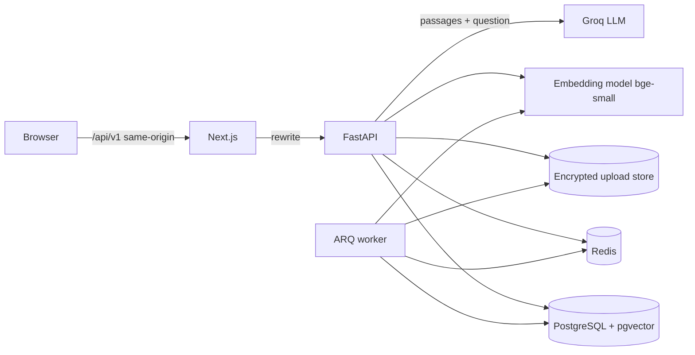
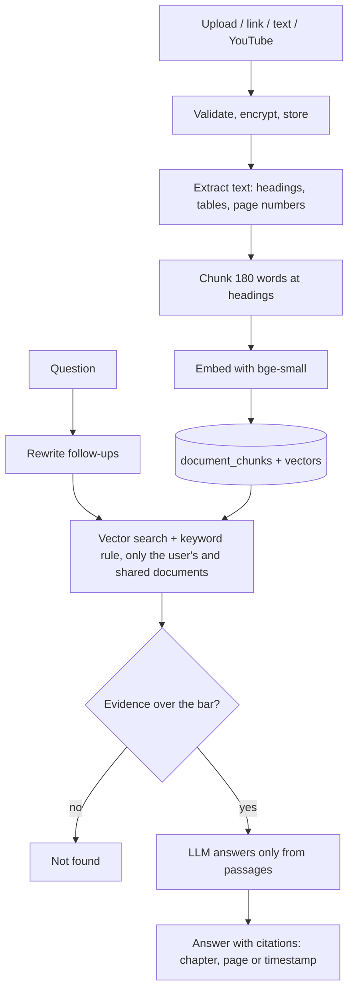
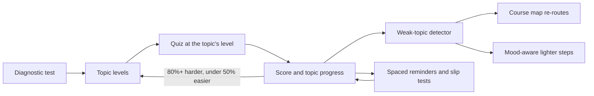
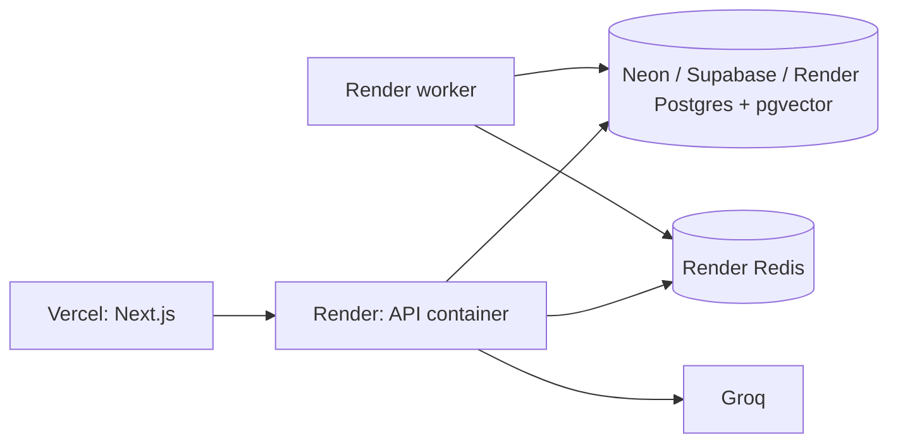

# Architecture

## System

The Next.js server forwards `/api/v1/*` to FastAPI, so the session cookie is first-party. Redis holds the job queue and rate-limit counters. The worker indexes uploads and sends the hourly study reminders.

## RAG flow

## Adaptive loop

## Deployment

Locally, `docker-compose.yml` runs the same pieces on one machine.

## Code layout
`backend/app/api/routes` (thin routes) → `services` (business rules) → `models` (SQLAlchemy). `schemas` holds the Pydantic types. `frontend/app` pages, `components` UI, `lib/api.ts` API client, `lib/features.ts` feature registry.
